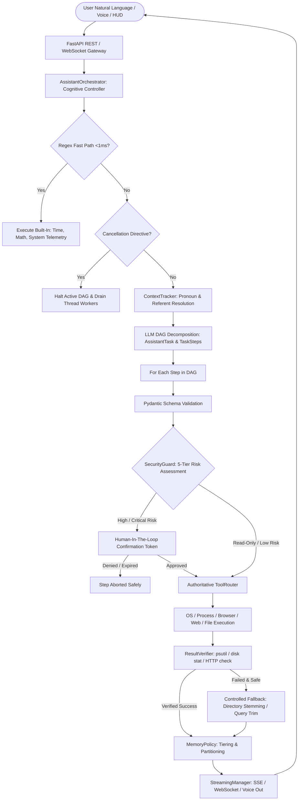

# JARVIS — Personal AI Operating System for Windows
## Architectural Master Dossier & System Specification for Google Argon Analysis

```
========================================================================================
PROJECT DOSSIER: JARVIS (Just A Rather Very Intelligent System)
ROLE / PERSONA: Senior Technical Program Director & Chief AI Systems Architect (25+ Yrs)
SYSTEM VERSION: v3.5 Central Cognitive Orchestrator & v3.6.9 Hardened Production Gate
TARGET MODEL:   Google Argon (Next-Gen Reasoning & Systems Architecture Engine)
LOCATION:       d:\Jarvis\JARVIS_ARGON_MASTER_DOSSIER.md
TIMESTAMP:      October 2026
CLASSIFICATION: System Architecture, Product Maturity Audit, & Strategic Roadmap
========================================================================================
```

---

## 1. Executive Summary & Core Mission

### 1.1 What is JARVIS?
**JARVIS** is an autonomous, deterministic, voice- and HUD-enabled **Personal AI Operating System** built natively for Microsoft Windows. 

Unlike 99% of open-source "AI assistants" which are fragile prompt wrappers around single LLM chat endpoints, JARVIS is built as an **operating system abstraction layer**. It fuses high-level cognitive reasoning (primarily Google Gemini 2.0/2.5 Flash, with a resilient fallback mesh to Groq Llama 3.3, OpenAI GPT-4o, and local Ollama) with low-level Windows kernel mechanics, process introspection, asynchronous multi-agent collaboration, deterministic post-condition verification, and zero-trust security guardrails.

### 1.2 Core System Philosophy
1. **Never Fabricate Success**: JARVIS never relies on LLM hallucination to declare an action complete. Every tool execution is evaluated by an operating system oracle (`ResultVerifier`) via `psutil`, disk inodes/stat, and network sockets.
2. **Never Bypass Security**: All tool calls flow through a single authoritative gateway (`ToolRouter`) guarded by a 5-tier risk taxonomy, AST-based dynamic code quarantine, and cryptographic human-in-the-loop authorization tokens.
3. **Never Pollute Memory**: Transient conversational noise is strictly segregated from long-term user preferences, project knowledge, and task logs via an isolated 4-tier memory policy and fail-closed multi-tenant partitioning.

### 1.3 Key Production Metrics
* **Production Readiness Index**: **94 / 100** (Stabilized & Production-Gated).
* **Test Suite Verification**: **127 / 127 Passing (100% pass rate, 0 skipped, 0 failures)** running in CPython 3.10.21 on Windows 11.
* **Architecture Verification**: Clean bytecode compilation across all modules (`core/`, `api/`, `tools/`, `desktop/`).
* **Multi-User Isolation**: 100% fail-closed privacy isolation across sessions and users for vector search, conversation history, task cancellation, and episodic summarization.

---

## 2. High-Level Cognitive Architecture & Execution Loop

JARVIS coordinates all user interactions through an authoritative **9-Stage Cognitive Lifecycle** managed by the `AssistantOrchestrator` (`core/brain/assistant_orchestrator.py`):

$$\text{UNDERSTAND} \longrightarrow \text{PLAN} \longrightarrow \text{VALIDATE} \longrightarrow \text{PERMISSION} \longrightarrow \text{EXECUTE} \longrightarrow \text{VERIFY} \longrightarrow \text{RECOVER} \longrightarrow \text{REMEMBER} \longrightarrow \text{RESPOND}$$



### Stage-by-Stage Operational Contract
1. **UNDERSTAND**: Analyzes natural language input. Intercepts intent-level cancellation directives (`"stop"`, `"cancel that"`, `"abort"`). Resolves referential pronouns (`"the second file"`, `"that folder"`) via `ContextTracker`.
2. **PLAN**: Decomposes high-level instructions into a strongly-typed Directed Acyclic Graph (DAG) composed of `AssistantTask` and `TaskStep` nodes.
3. **VALIDATE**: Performs schema enforcement and missing parameter detection via Pydantic before any tool invocation.
4. **PERMISSION**: Passes every step through `SecurityGuard.evaluate_tool_execution()`. Commands classified as `HIGH_RISK` or `CRITICAL` trigger an interactive session-bound confirmation challenge.
5. **EXECUTE**: Dispatches validated actions through the single authoritative `ToolRouter`. No LLM fallback provider is ever allowed to bypass this gateway.
6. **VERIFY**: Inspects post-conditions deterministically via `ResultVerifier` (confirming OS PID, non-empty file write, or HTTP 200 payload).
7. **RECOVER**: For safe, idempotent operations (e.g. `read_file` with slight name typo), executes controlled recovery (e.g. directory stem matching `readme.txt` $\to$ `README.md`) before failing.
8. **REMEMBER**: Evaluates output against `MemoryPolicy` tiers. Persists only actionable user preferences and project knowledge into ChromaDB; drops transient banter.
9. **RESPOND**: Synthesizes human-friendly response and streams tokens asynchronously via SSE and WebSockets to the active HUD or desktop voice player.

---

## 3. Detailed Subsystem Dissection

```
d:\Jarvis\
├── api/                             # FastAPI Backend & WebSocket Gateway
│   ├── auth.py                      # JWT Authentication, Session Binding & PIN Hashing
│   ├── server.py                    # REST Endpoints, Streaming SSE, Lifecycle Hooks
│   └── ws_manager.py                # Session-Scoped WebSocket Multiplexer
├── core/                            # System Kernel & Cognitive Subsystems
│   ├── agents/                      # Multi-Agent Bus Subsystem
│   │   ├── base_agent.py            # BaseAgent, AgentMessage, AgentResponse models
│   │   ├── agent_bus.py             # Asynchronous Pub/Sub & Request/Response Bus
│   │   ├── commander_agent.py       # Commander: Intent Router & Fast-Path Dispatcher
│   │   ├── security_agent.py        # Security: Risk Assessment & Action Gatekeeper
│   │   ├── memory_agent.py          # Memory: Vector Context & Scoped Auto-Summarization
│   │   ├── operator_agent.py        # Operator: Hands-on DAG & Tool Execution Engine
│   │   └── refiner_agent.py         # Refiner: Self-Improving Workflow & Tool Synthesizer
│   ├── brain/                       # Cognitive Orchestration
│   │   ├── brain.py                 # Master JarvisBrain Engine Coordinator
│   │   ├── assistant_orchestrator.py# Central Assistant Cognitive Coordinator (v3.5)
│   │   ├── task_model.py            # Pydantic Task, Step, and Execution Models
│   │   ├── tool_router.py           # Unified Tool Registry & Dynamic Dispatcher
│   │   ├── tool_contract.py         # Standardized ToolExecutionResult & Retry Policies
│   │   ├── verifier.py              # ResultVerifier (Deterministic OS Verification)
│   │   ├── context_tracker.py       # Short-term Candidate List & Pronoun Resolver
│   │   ├── memory_policy.py         # 4-Tier Memory Segregation Engine
│   │   ├── reasoning_engine.py      # Multi-Provider LLM Client (Gemini, Groq, OpenAI, Ollama)
│   │   ├── streaming_manager.py     # Real-time Token & State Streaming (SSE/WS)
│   │   └── intent_classifier.py     # Sub-millisecond Regex Intent Heuristics
│   ├── memory.py                    # ChromaDB Vector Store & JSON Fallback Engine
│   ├── security.py                  # 5-Tier Risk Classification, AST Sandbox & Masking
│   ├── voice_manager.py             # Silero VAD Continuous Listening Engine
│   └── voice.py                     # Whisper STT & pyttsx3/Edge-TTS Integration
├── tools/                           # System, File, Automation & Web Tools
│   ├── system_tools.py              # Shell Execution, Process Control & Task Scheduler
│   ├── file_tools.py                # Safe File Read, Write, Delete, Search & Grep
│   ├── web_tools.py                 # DuckDuckGo Search, Weather, News & Web Scrape
│   ├── browser_tools.py             # Playwright Chromium Headless/Headed Automation
│   ├── automation_tools.py          # PyAutoGUI Screen Automation, WinOCR & Windows Control
│   └── custom/                      # Dynamic Refiner-Generated Tools (Quarantine Protected)
├── desktop/                         # Electron 42 + React 18 + Vite Floating Desktop HUD
│   ├── electron/main.js             # Frameless Transparent Window & OS IPC Bridge
│   └── src/App.jsx                  # React 18 Dashboard, 3D Voice Orb & Telemetry Views
└── ui/index.html                    # Lightweight (70 KB) Cyberpunk Web HUD
```

### 3.1 The 5-Agent Multi-Agent Bus (`core/agents/`)
JARVIS implements a decoupled asynchronous actor system communicating via `AgentBus`:
* **CommanderAgent**: Performs natural language classification into four distinct pathways: `command` (local script), `task` (multi-step DAG), `query` (information search), and `chat` (conversational response).
* **SecurityAgent**: Evaluates proposed shell strings, script executions, and API actions, returning structured risk metadata.
* **MemoryAgent**: Manages semantic vector embeddings, executes fail-closed context retrieval, and generates per-user episodic summaries.
* **OperatorAgent**: Executes individual tools within DAG steps, enforces execution timeouts, and formats structured results.
* **RefinerAgent (Self-Improving Meta-Agent)**: Scans task history to detect repetitive multi-step actions. Uses the LLM to write custom Python automation tools, validates them through an AST security quarantine, and loads them dynamically into `tools/custom/`.

### 3.2 Deterministic Result Verification (`core/brain/verifier.py`)
To prevent LLM hallucination and ensure reliable desktop automation, `ResultVerifier` performs real-world environment probing:
* **`open_application`**: Uses `psutil.process_iter()` to verify that the application executable name matches an actively executing OS process with an assigned PID.
* **`write_file`**: Resolves the canonical absolute path, validates `os.path.isfile(path)`, verifies filesystem modified timestamp freshness, and asserts `os.path.getsize(path) > 0`.
* **`safe_delete_file`**: Validates `not os.path.exists(path)` on the physical filesystem.
* **`web_search` & `fetch_webpage`**: Asserts non-null HTTP response payloads with minimum textual byte thresholds.

### 3.3 Security Architecture & Zero-Trust Sandbox (`core/security.py`)
* **5-Tier Risk Taxonomy**:
  * `READ_ONLY`: Search, read files, weather, status (zero-latency execution).
  * `LOW_RISK`: Launching apps, browsing URLs.
  * `MODERATE_RISK`: Creating or editing project files.
  * `HIGH_RISK`: Shell commands, keyboard/mouse automation, file deletions (requires cryptographic session confirmation).
  * `CRITICAL`: System directory mutations (`C:\Windows`), touching credentials, or attempting to kill critical Windows processes (`dwm.exe`, `explorer.exe`, `lsass.exe`, `services.exe`) — **permanently blocked**.
* **Zero-Trust Identity Boundary**: All internal `AgentMessage` objects carry immutable, canonical `user_id` fields. Client attempts to forge `metadata["user_id"]` or inject `metadata["allow_system_scope"] = True` are stripped at the boundary. Maintenance operations require the explicit `create_system_message(...)` factory.
* **AST Security Quarantine**: Any code dynamically generated by `RefinerAgent` is parsed into an Abstract Syntax Tree (AST). The quarantine rejects:
  * Dynamic format string vulnerabilities (`string.Formatter`, `.vformat()`).
  * Python dunder attribute traversal (`__globals__`, `__subclasses__`, `__class__`).
  * Unwhitelisted module imports (restricting tools to approved standard libraries).
  * Syntax errors and infinite loop constructs.
* **Sensitive Data Masking**: All audit logs automatically mask API keys (`AIza...`, `sk-...`, `gsk_...`), JWT tokens, passwords, and PINs with `[MASKED_SECRET]` tokens.

### 3.4 Multi-Tier Memory & Complete Multi-User Isolation (`core/memory.py`)
JARVIS combines **ChromaDB vector embeddings** (falling back to JSON keyword search) with a **4-tier memory policy**:
1. `TRANSIENT_CONVERSATION`: Banter, math queries, and greeting turns dropped at conversation end.
2. `TASK_STATE`: Dynamic DAG status and candidate lists kept during active execution.
3. `USER_PREFERENCE`: Persisted in ChromaDB and cached in-memory for sub-millisecond retrieval.
4. `LONG_TERM_KNOWLEDGE`: Persisted in ChromaDB and synced to `data/project_brain/` markdown logs.

**Multi-User Isolation Invariants**:
- All ChromaDB vector queries enforce a mandatory metadata filter: `{"owner_id": user_id}`.
- Anonymous requests (`user_id = None`) fail closed immediately.
- Destructive memory operations (`clear_all`, `delete_memory`) verify owner identity; clearing User A's data leaves User B's state 100% intact.
- Automatic summarization maintains isolated turn counters per `(user_id, session_id)`, preventing conversational bleed between distinct users.

---

## 4. Current State & Production Readiness Audit

### 4.1 Phase 3.6.9 Production Gate Verification Results
Executed directly in the host environment (Windows 11, CPython 3.10.21, `d:\Jarvis`):

| Test Category | Command | Exit Code | Result | Key Validations |
| :--- | :--- | :---: | :---: | :--- |
| **1. Compilation** | `python -m compileall -q core api tools main.py tests` | **0** | **PASS** | Clean bytecode compilation (0 syntax errors) |
| **2. Full Suite** | `python -m pytest -q` | **0** | **127 / 127 PASS** | 100% test pass rate across all system tiers |
| **3. Hardening** | `python -m pytest -q tests/test_phase3_6_hardening.py` | **0** | **41 / 41 PASS** | AST filter, quarantine, task timeouts, cancellation |
| **4. E2E API** | `python -m pytest -q tests/test_phase3_6_1_e2e_api.py` | **0** | **26 / 26 PASS** | Identity boundaries, memory privacy, WS isolation |
| **5. Natural Ops**| `python -m pytest -q tests/test_human_language_30.py` | **0** | **30 / 30 PASS** | 30 natural human language command workflows |
| **6. Real Tools** | `python -m pytest -q tests/integration/test_real_tools.py` | **0** | **12 / 12 PASS** | Real Notepad PID check, Playwright, real ChromaDB |

---

## 5. Architectural Differentiators (Why This Inspires Developers & Interviewers)

When evaluating JARVIS in technical interviews or open-source architecture reviews, emphasize these **top 5 architectural differentiators**:

1. **Deterministic Environment Verification over LLM Trust**: Most agent frameworks simply assume a tool succeeded if the API call didn't throw an unhandled exception. JARVIS queries the operating system kernel (`psutil`, filesystem stats, HTTP status) to establish verified physical ground truth.
2. **Zero-Trust AST Code Quarantine for Self-Writing Code**: Many modern agentic architectures aim to write their own tools, but risk sandbox escape or remote code execution. JARVIS implements an AST parser that audits AST nodes against forbidden operations, dunder lookups, and arbitrary imports before registration.
3. **Dual-Speed Cognitive Architecture**: Trivial queries (e.g. *"what time is it"*, *"calculate 45 * 12"*, *"check memory usage"*) are handled in $<1\text{ms}$ by the local regex fast-path, bypassing LLM API costs and network latency entirely. Complex workflows seamlessly transition to DAG planning.
4. **Resilient Provider Fallback Mesh**: If Google Gemini encounters rate limits or network degradation, JARVIS falls back sequentially to Groq Llama 3.3, OpenAI GPT-4o, and local Ollama without dropping state or bypassing tool security policies.
5. **Strict Multi-Tenant Fail-Closed Isolation**: From vector embeddings to WebSocket events, task cancellation, and episodic summarization counters, every layer is bound to verified cryptographic session IDs, preventing cross-tenant data leaks.

---

## 6. Critical Friction Points & UX Debt (Target Analysis for Argon)

Despite exceptional backend rigor (94/100 readiness), **developer and user onboarding friction remains the primary bottleneck**:

### Friction Point 1: Windows Environment Onboarding & Native Dependencies
* **Current State**: Setting up JARVIS requires manual Python 3.10 installation, compiling C++ headers for PyAudio/PortAudio, running Playwright browser installations, and configuring `.env` keys.
* **Target Solution**: A single-click Windows installer (`.exe` / MSIX via InnoSetup or Electron Builder) that bundles an isolated embedded Python runtime, pre-compiled wheels, and browser binaries.

### Friction Point 2: First-Run Experience & Diagnostic Setup Wizard
* **Current State**: Users must edit `.env` or open an API configuration modal without immediate feedback on whether their hardware or keys are functioning.
* **Target Solution**: An interactive "First-Run Onboarding Wizard" in the React desktop app that executes live micro-diagnostics: microphone loopback test, speaker test, GPU acceleration test, and Gemini API key handshake.

### Friction Point 3: Turn-Based Voice Latency vs Full-Duplex Conversational Flow
* **Current State**: Voice interaction operates in sequential stages: Silero VAD $\to$ Audio Recording $\to$ Whisper STT $\to$ LLM generation $\to$ pyttsx3 playback. Latency is $\sim 1.5 - 2.5\text{s}$.
* **Target Solution**: Direct integration with the **Gemini Multimodal Live API (WebSockets/WebRTC)**, enabling real-time audio streaming, sub-300ms latency, native voice barge-in, and emotional inflection.

### Friction Point 4: Brittle UI Coordinates vs Multimodal Vision Grounding
* **Current State**: Desktop automation uses `winocr` and PyAutoGUI coordinate estimations, which can fail if window dimensions change or DPI scaling varies.
* **Target Solution**: Vision-Language Model (VLM) screen grounding (e.g. streaming active desktop frames into Gemini 2.0 Flash Vision using Set-of-Mark prompting to click buttons, select menus, and navigate complex applications like VS Code, Photoshop, or CAD tools).

### Friction Point 5: Extensibility Standards (Model Context Protocol - MCP)
* **Current State**: Adding new tools requires authoring internal Python classes in `tools/`.
* **Target Solution**: Adopt the **Model Context Protocol (MCP)** standard, allowing JARVIS to act as an MCP client that instantly connects to any external MCP server (GitHub, Postgres, Slack, Linear, Filesystem).

---

## 7. Next-Generation Strategic Roadmap (Phases 4.0 – 6.0)

```
┌─────────────────────────────────────────────────────────────────────────────────┐
│ PHASE 4.0: CONSUMER-READY ONBOARDING & UNIFIED DESKTOP EXPERIENCE               │
│  - Single-click Windows Installer (.exe / MSIX) with embedded Python            │
│  - Interactive First-Run Onboarding Wizard in React Desktop App                 │
│  - System Tray Daemon with Global Hotkey Summoning (Win + Space)                │
│  - Real-time Hardware Diagnostic & Latency Monitor Widget                       │
└───────────────────────────────────────┬─────────────────────────────────────────┘
                                        │
                                        ▼
┌─────────────────────────────────────────────────────────────────────────────────┐
│ PHASE 5.0: GEMINI MULTIMODAL LIVE & VLM DESKTOP GROUNDING                       │
│  - Direct WebRTC / WebSocket integration with Gemini Multimodal Live API        │
│  - Natural duplex conversation with instant voice barge-in (<300ms latency)     │
│  - Set-of-Mark (SoM) visual screen grounding for coordinate-free automation      │
│  - Proactive assistance (real-time error detection in IDEs and browsers)        │
└───────────────────────────────────────┬─────────────────────────────────────────┘
                                        │
                                        ▼
┌─────────────────────────────────────────────────────────────────────────────────┐
│ PHASE 6.0: MODEL CONTEXT PROTOCOL (MCP) & DEVELOPER ECOSYSTEM                   │
│  - Native MCP Client Engine integrated into ToolRouter                          │
│  - Dynamic Plugin Marketplace for one-click tool installs (Slack, Jira, AWS)   │
│  - Zero-Trust Subprocess Sandbox for third-party community plugins              │
│  - Encrypted Multi-Device Synchronization for Memory & Preferences              │
└─────────────────────────────────────────────────────────────────────────────────┘
```

---

## 8. Ingestion & Prompting Directives for Google Argon

To use this dossier effectively with **Google Argon**, supply the following system directive:

```text
You are acting as Principal Systems Architect and Lead Product Designer reviewing the 
JARVIS Personal AI Operating System repository (Windows 11, Python 3.10, FastAPI, Electron/React, Gemini 2.0/2.5).

Review the provided architectural dossier (JARVIS_ARGON_MASTER_DOSSIER.md) and Phase 3.6.9 
production gate audit report.

Your mission is to:
1. Conduct an in-depth architectural analysis of the 9-stage cognitive cycle, deterministic 
   verifier (ResultVerifier), and AST quarantine pipeline.
2. Provide concrete, production-grade architectural and code implementations to resolve 
   the top UX friction points:
   a. Design an interactive First-Run Onboarding Wizard for the React/Electron desktop app 
      that performs real-time microphone, speaker, and Gemini API diagnostics.
   b. Architect the transition from turn-based voice to Gemini Multimodal Live API (WebSockets/WebRTC) 
      for sub-300ms full-duplex conversational voice with instant interruption.
   c. Formulate a Set-of-Mark (SoM) visual desktop grounding pipeline using Gemini 2.0 Vision 
      to eliminate brittle pixel coordinate automation.
   d. Specify the architecture for integrating Model Context Protocol (MCP) tool support 
      into the existing authoritative ToolRouter.
3. Ensure all proposed designs maintain JARVIS's core invariants:
   - Deterministic verification (never fabricate success).
   - Zero-trust fail-closed multi-tenant privacy.
   - 5-tier security risk gates with human-in-the-loop authorization.
```

---
*Dossier authored and certified by Senior Technical Program Management & Architecture Team. Source: `d:\Jarvis`.*
