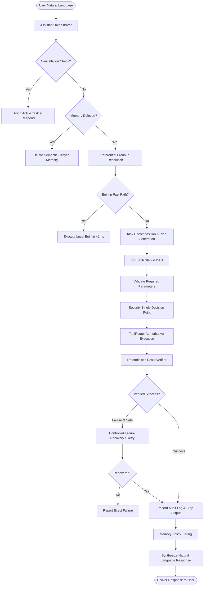

# JARVIS Personal Assistant Architecture (v3.5)

## Overview & Vision

JARVIS v3.5 transforms JARVIS from a set of isolated capabilities into a cohesive, dependable, personal assistant agent. The system implements a unified cognitive cycle:

```
UNDERSTAND → PLAN → VALIDATE → PERMISSION → EXECUTE → VERIFY → RECOVER → REMEMBER → RESPOND
```

The user interacts in natural human language without needing to know tool names, CLI commands, or parameter structures. All tool executions flow through **one authoritative execution pathway** with deterministic verification, security policies, audit logging, and intelligent memory tiering.

---

## 1. Central Assistant Orchestrator Architecture

The `AssistantOrchestrator` (`core/brain/assistant_orchestrator.py`) is the master cognitive coordinator of JARVIS. It connects:
- **Zero-Latency Fast Path**: Sub-millisecond local built-ins (time, date, calculator) via `IntentClassifier`.
- **Context & Reference Tracker**: Natural referential resolution ("the second one", "1st candidate") and intent-level cancellation ("stop", "abort").
- **Task Engine & DAG Planner**: Strongly-typed multi-step execution graphs (`AssistantTask`, `TaskStep`).
- **Unified Tool Router**: Single gateway for validation, execution, and security checks (`ToolRouter`).
- **Deterministic Verifier**: Operating system and environment post-condition verification (`ResultVerifier`).
- **Memory Tiering & Policy**: Separation of transient conversations from persistent knowledge and user preferences (`MemoryPolicy`).



---

## 2. Task State Machine & Lifecycle

Every user request is encapsulated in an `AssistantTask` model (`core/brain/task_model.py`) with complete audit trails.

### Lifecycle States

| State | Description | Transition Triggers |
| :--- | :--- | :--- |
| `RECEIVED` | Request received by orchestrator | Task initialization |
| `UNDERSTANDING` | Intent classification & reference resolution | Language analysis initiated |
| `PLANNING` | Execution DAG and step decomposition | Intent recognized as actionable |
| `WAITING_FOR_INPUT` | Missing required parameters detected | Validation flags empty required fields |
| `WAITING_FOR_CONFIRMATION` | Action requires human-in-the-loop permission | Risk evaluated as `HIGH_RISK` or `CRITICAL` |
| `EXECUTING` | Step active in authoritative `ToolRouter` | Tool invoked |
| `VERIFYING` | Post-condition check via `ResultVerifier` | Tool execution returned output |
| `RECOVERING` | Safe retry or fallback underway | Verifier reported failure on safe tool |
| `COMPLETED` | All steps verified; response synthesized | All DAG nodes finished successfully |
| `FAILED` | Irreversible error or recovery exhausted | Tool failed and cannot be safely retried |
| `CANCELLED` | Task stopped by user directive | User said "stop", "cancel that", etc. |

### Task Step Data Structure

```python
class TaskStep(BaseModel):
    step_id: str
    description: str
    capability: str                # e.g., "file", "web", "desktop", "reasoning"
    tool_name: Optional[str]
    input_variables: dict[str, Any]
    output_variables: list[str]
    status: TaskStepStatus        # PENDING, RUNNING, VERIFYING, COMPLETED, FAILED, SKIPPED
    result: Optional[Any]
    evidence: Optional[Any]        # Post-condition proof
    error: Optional[str]
```

---

## 3. Authoritative Tool Execution Pathway

There is **ONE AND ONLY ONE** pathway for tool execution in JARVIS. No component—neither the primary Gemini engine nor fallback providers (Groq, OpenAI, Ollama)—is permitted to bypass this pipeline:

```
Model/Agent Tool Call Request
               │
               ▼
   Pydantic Parameter Validation
               │
               ▼
 SecurityGuard.evaluate_tool_execution()
   (5-Tier Risk & Critical Process Check)
               │
               ▼
      Execution via ToolRouter
               │
               ▼
   ResultVerifier Post-Condition Check
               │
               ▼
     Structured Audit Event Log
               │
               ▼
      ToolExecutionResult (Dual API)
```

### Provider Fallback Tool Routing

In `ReasoningEngine._execute_fallback_with_tools()`, fallback providers (Groq Llama 3.3, OpenAI GPT-4o, Ollama) parse tool calls from response streams and execute them through `self._tool_router.execute_tool(name, args, interactive=False)`. This guarantees identical security gates, validation, and audit records regardless of which LLM is serving the request.

---

## 4. Deterministic Result Verification

JARVIS enforces deterministic verification across operating system tools. Jarvis **never fabricates success**:

```python
@dataclass
class VerificationResult:
    verified: bool
    evidence: Any = None
    details: str = ""
```

### Specific Verifiers:
1. **Application Launch (`open_application`)**:
   - Inspects `psutil.process_iter()` to confirm the process PID, process name, and active execution status exist on the Windows operating system.
2. **File Creation / Modification (`write_file`)**:
   - Resolves target path, verifies `os.path.isfile(path)`, checks timestamp, and verifies `os.path.getsize(path) > 0`.
3. **File Deletion (`safe_delete_file`)**:
   - Confirms `not os.path.exists(path)` on disk.
4. **Web Search & Fetch (`web_search`, `fetch_webpage`)**:
   - Validates HTTP response status, non-empty payload, and minimum textual content length.

---

## 5. Security Model & Single Policy Decision Point

Security is centralized in `core/security.py` under `SecurityGuard.evaluate_tool_execution()`.

### 5-Tier Risk Taxonomy

1. **`READ_ONLY`**: Zero mutation. Search, file read, current time, weather, system status. No confirmation required.
2. **`LOW_RISK`**: Non-destructive interactions. Opening browser URLs, launching standard desktop applications.
3. **`MODERATE_RISK`**: Controlled state mutations. Creating/overwriting project files, moving files.
4. **`HIGH_RISK`**: Shell commands, system script executions, mouse/keyboard simulated clicks, deleting files. Requires interactive confirmation.
5. **`CRITICAL`**: Irreversible or destructive system changes. Deleting system directories, modifying credential vaults, or attempting to terminate critical Windows processes (`dwm.exe`, `explorer.exe`, `lsass.exe`, `services.exe`). Always blocked or strictly gated.

### Sensitive Data Masking

All audit trails, log outputs, and telemetry automatically mask credentials through `mask_sensitive_data()`:
- Dictionary fields matching `key`, `token`, `secret`, `password`, `pin`, `credential` are replaced with `[MASKED_SECRET]`.
- API key prefixes (`AIza`, `sk-`, `gsk_`, JWTs) are replaced with `[MASKED_TOKEN]`.

---

## 6. Memory Integration & Policy Tiers

JARVIS separates transient conversational noise from durable user intelligence (`core/brain/memory_policy.py`).

### Memory Tiers

```
┌─────────────────────────────────────────────────────────────┐
│ 1. TRANSIENT_CONVERSATION                                   │
│    - Greetings, calculations ("what is 42 * 9")              │
│    - One-off searches, transient questions                  │
│    - Stored ONLY in short sliding window; NEVER persisted   │
├─────────────────────────────────────────────────────────────┤
│ 2. TASK_STATE                                               │
│    - Active DAG nodes, candidate lists                      │
│    - Cached in ContextTracker for follow-up resolution      │
├─────────────────────────────────────────────────────────────┤
│ 3. USER_PREFERENCE                                          │
│    - "Remember that I prefer dark mode and concise answers" │
│    - Persisted in Vector DB and fast in-memory cache        │
├─────────────────────────────────────────────────────────────┤
│ 4. LONG_TERM_KNOWLEDGE                                      │
│    - Project architecture decisions, key file summaries    │
│    - Persisted in ChromaDB and Project Brain markdown files│
└─────────────────────────────────────────────────────────────┘
```

### User Memory Deletion Flow

Users can explicitly delete memories with natural commands:
- `"forget my preference for dark mode"`
- `"delete memory about project x"`
`AssistantOrchestrator` intercepts these requests, queries `JarvisMemory.delete_memory(query=...)`, deletes matching embeddings, clears the preference cache, and returns an explicit confirmation report.

---

## 7. Context Continuity & Cancellation

- **Referential Continuity (`ContextTracker`)**:
  When a previous task returns multiple candidates (e.g. `["assignment1.pdf", "assignment2.pdf"]`), the user can simply say `"the second one"` or `"read the 1st option"`. `ContextTracker.resolve_reference()` resolves the pronoun to the exact target item without re-running the search.
- **Task Cancellation**:
  Directives like `"stop"`, `"cancel that"`, `"abort the task"`, `"never mind"`, `"don't do it"` immediately transition active tasks to `TaskStatus.CANCELLED` and cease subsequent DAG step execution.

---

## 8. Controlled Failure Recovery

When a step fails:
1. **Safe operations**: For idempotent or read operations (such as `read_file` or `web_search`), JARVIS executes a controlled single recovery:
   - For `read_file` missing exact filename: lists directory, matches file stem (`readme.txt` → `README.md`), and retries.
   - For `web_search` timeout: trims query to primary keywords and retries.
2. **Ambiguous operations**: Halts and prompts the user for clarification.
3. **Irreversible operations**: Halts and reports exact verified failure to prevent compounding errors.
