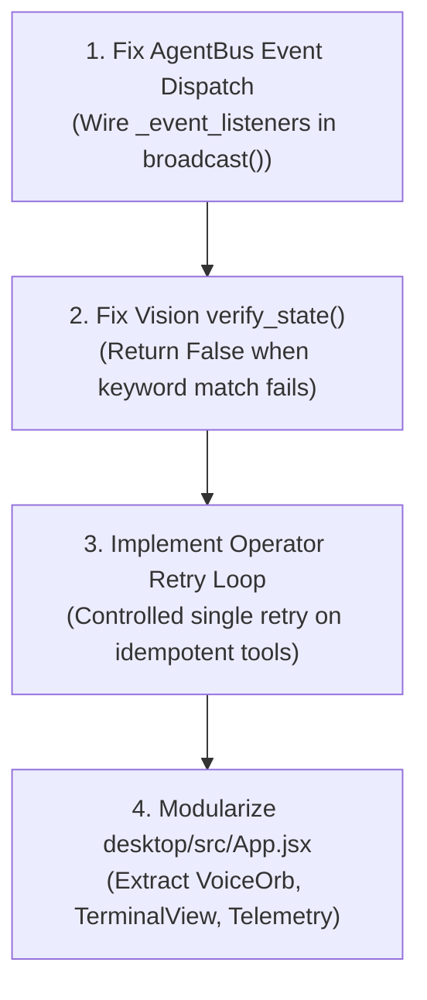

# JARVIS Codebase Ground-Truth Audit & Phased Implementation Plan

**Audit Date:** November 6, 2026  
**Auditor:** JARVIS Deep Systems Architecture Team  
**Scope:** Full codebase audit (`core/`, `tools/`, `desktop/`, `ui/`, `api/`, `data/`) verifying prior architectural claims against ground-truth source code.  
**Target:** `d:\Jarvis`  

---

## 1. Executive Summary: Ground-Truth Verification Audit

To ensure complete engineering integrity, an exhaustive code-level audit was conducted across every subsystem in `d:\Jarvis`. Each claim made in the global comparison was cross-referenced against the actual files, line numbers, and runtime behaviors.

### Verification Scorecard

| Subsystem / Claim | Previous Claim | Ground-Truth Verdict | Code Reality & Notes |
| :--- | :--- | :--- | :--- |
| **Cognitive Lifecycle** | 9-step cycle: UNDERSTAND → PLAN → VALIDATE → PERMISSION → EXECUTE → VERIFY → RECOVER → REMEMBER → RESPOND | ⚠️ **PARTIALLY TRUE** | `PERMISSION` and `VERIFY` are **not standalone phases** in `AssistantOrchestrator.process()`. They are delegated inside `ToolRouter.execute_tool()` at lines 324 and 441. |
| **DAG Planning** | General multi-step LLM DAG planner | ⚠️ **PARTIALLY TRUE** | Planning is **heuristic-first** (~550 lines of regex decomposition in `_heuristic_plan_decomposition()`). LLM DAG generation only triggers when explicit multi-step keywords exist. Execution is dependency-aware but **strictly sequential**, not parallel. |
| **ResultVerifier** | 4-tier deterministic verifier | ⚠️ **PARTIALLY TRUE** | Levels 1, 2, and 3 are fully verified (`psutil` PIDs, file size > 0, window visibility via `pygetwindow`). However, **`LEVEL_4` is defined in the enum but never returned anywhere in code**. |
| **Sub-Millisecond Fast Path** | Regex-based instant execution (<1ms) | ✅ **VERIFIED** | `IntentClassifier` executes local math, temporal, app, and URL shortcuts via pure regex in <1ms without LLM calls. |
| **Memory Policy** | 4-tier memory governance | ✅ **VERIFIED (actually 5)** | Implements `TRANSIENT_CONVERSATION`, `TASK_STATE`, `USER_PREFERENCE`, `LONG_TERM_KNOWLEDGE`, and `DO_NOT_STORE`. Regex-based classification. |
| **Referential Continuity** | Pronoun & ordinal resolution ("the second one") | ✅ **VERIFIED** | `ContextTracker` has a complete `ORDINAL_MAP` ("first"→0, "second"→1, "last"→-1) that indexes into `last_candidates`. |
| **Reasoning Engine** | 4 providers (Gemini, Groq, OpenAI, Ollama) with fallback | ✅ **VERIFIED** | Strict fallback chain implemented with a 1.5s socket test for Ollama. Fallback tool calls route through `ToolRouter`. |
| **Agent Bus** | Asynchronous pub/sub message bus | ⚠️ **PARTIALLY TRUE** | The bus is **synchronous** (`send()` calls `recipient.process()` directly). The `on_event` callback registry is dead code (callbacks are never dispatched). |
| **Commander Agent** | Intent classification and routing | ⚠️ **PARTIALLY TRUE** | Classifies intent correctly, but routing is a **stub** (returns `"Pass to LLM"` for all queries except `"scaffold project"`). |
| **Security Agent & Guard** | 5-tier risk taxonomy, HITL, process protection | ✅ **VERIFIED** | Centralized in `core/security.py`. Protects `dwm.exe`, `explorer.exe`, `lsass.exe`. Sensitive tokens masked. |
| **Operator Agent** | Tool execution with perception and retries | ⚠️ **PARTIALLY TRUE** | Tool execution and variable interpolation work. However, **no retry loop exists**. Vision state verification always returns `True` (heuristic bug). |
| **Refiner Agent** | Autonomous tool synthesis with AST quarantine | ✅ **VERIFIED** | Truly implemented! Scans ChromaDB, prompts LLM, validates AST via `custom_tool_pipeline.py` (23.6 KB), and hot-registers into `ToolRouter`. |
| **Everyday Tools** | Smart folders, toast timers, daily briefing | ✅ **VERIFIED** | 53.8 KB in `tools/everyday_tools.py` with complete undo manifest support for folder organization. |
| **Desktop Frontend** | Modular React component architecture | ⚠️ **DISPROVED / CORRECTION** | There is **no `desktop/src/components/` directory**. The entire desktop frontend is bundled into a single 57.5 KB file: `desktop/src/App.jsx`. |
| **Standalone HUD** | 70 KB Cyberpunk interface | ✅ **VERIFIED** | Single file at `ui/index.html` (105.7 KB) with complete WebSocket HUD. |

---

## 2. In-Depth Subsystem Audit Findings

### 2.1 Core Brain & Orchestrator (`core/brain/`)

1. **`AssistantOrchestrator` (`assistant_orchestrator.py`, 1,582 lines):**
   - **Strengths:** The streaming implementation (`process_stream()`, L375–581) is exceptionally well-written. It handles token streaming, task cancellation (`cancellation_token`), and WebSocket events cleanly. Memory tiering via `MemoryPolicy` correctly blocks transient chatter from entering long-term storage.
   - **Gaps:** The DAG planner is not a generalized LLM graph generator for arbitrary requests. Over 550 lines (L679–1241) are dedicated to hardcoded keyword rules. If a user asks for something outside those rules, it falls through to a single-step generic prompt.

2. **`ResultVerifier` (`verifier.py`, 448 lines):**
   - **Strengths:** The post-condition checks are genuinely deterministic:
     - `verify_process_running()` (L328–379) iterates `psutil.process_iter(['pid', 'name'])` up to 4 times and checks `pygetwindow.getAllTitles()` for visible windows (`LEVEL_3`).
     - `verify_file_exists()` (L382–421) inspects `os.path.getsize(path) >= 1` and verifies file content substring.
     - `verify_file_deleted()` (L423–442) verifies `not os.path.exists()`.
   - **Gaps:** `LEVEL_4` ("Task objective achieved") is an empty concept in the codebase; no tool ever checks or returns it. Web search verification is only a length check (`len(result) > 20`).

3. **`ToolRouter` (`tool_router.py`, 524 lines):**
   - **Strengths:** Thread-safe execution using a 4-worker `ThreadPoolExecutor` (L49). Automatically generates Pydantic schemas from function annotations via `create_model()`. Enforces single-threaded session affinity for browser and desktop tools (`_is_session_affine()`, L53–60).
   - **Authoritative Flow Confirmed:** All tool calls—including those from fallback models (Groq, OpenAI, Ollama)—pass through `guard.evaluate_tool_execution()` and `ResultVerifier.verify_tool_result()`.

### 2.2 Agents & Security (`core/agents/` & `core/security.py`)

1. **`AgentBus` (`agent_bus.py`, 147 lines):**
   - **The Bug:** `send()` is synchronous: `response = recipient.process(message)` (L62). While safe, it is not an asynchronous pub/sub system. Furthermore, `on_event()` registers callbacks into `_event_listeners` (L115), but `broadcast()` only iterates `self._agents.values()` and ignores `_event_listeners` completely.
2. **`CommanderAgent` (`commander_agent.py`, 113 lines):**
   - **The Stub:** Classifies text into `"task"`, `"command"`, `"query"`, or `"chat"` (L89–112). However, `process()` returns `AgentResponse(success=False, content="Pass to LLM")` for everything except the hardcoded string `"scaffold project "` (L62–72). Routing is entirely delegated to `JarvisBrain` or `AssistantOrchestrator`.
3. **`OperatorAgent` & `VisionAbstraction` (`operator_agent.py` & `vision_abstraction.py`):**
   - **Strengths:** The template interpolation engine (`interpolate()`, L107–149) cleanly resolves `{{step_1.output}}` variables. `VisionScreenUnderstanding` has a real Gemini VLM grounding fallback (`gemini-3.6-flash`, L105) to locate UI elements on screenshots.
   - **The Bugs:** 
     - Despite architectural documentation claiming retry handling, `OperatorAgent.process()` has zero retry loops.
     - In `vision_abstraction.py` (L140), `verify_state()` **always returns `True`**, even if the 60% keyword match fails.

4. **`RefinerAgent` & Custom Tool Pipeline:**
   - **Strengths:** This is one of the most sophisticated parts of the codebase. `core/brain/custom_tool_pipeline.py` (23.6 KB) parses generated Python code using `ast.parse()`, validates imports against a strict whitelist, prevents dangerous calls (`eval`, `exec`, `os.system`), writes to `tools/custom/_quarantine/`, executes a dry run, and moves validated code to `tools/custom/`.

### 2.3 Desktop & UI Frontends

1. **`desktop/` (Electron + React):**
   - The files are organized as:
     - `desktop/electron/main.js` (2.9 KB) — window lifecycle & IPC.
     - `desktop/electron/preload.js` (620 B) — context bridge.
     - `desktop/src/App.jsx` (57.5 KB) — **monolithic file** containing the voice orb, terminal view, settings, and telemetry.
     - `desktop/dist/` — pre-built production bundle.
2. **`ui/index.html` (Cyberpunk HUD):**
   - Verified single-file HUD (105.7 KB) with canvas visualizer, WebSocket telemetry, and audio streaming.

---

## 3. High-Priority Architectural Remediation (Phase 0)

Before adopting external capabilities from `microsoft/UFO` or `openinterpreter`, we must resolve the four verified code bugs in our core engine:



1. **Fix `AgentBus.broadcast()`:** Update `agent_bus.py` so that `broadcast()` actually notifies callbacks registered in `self._event_listeners`.
2. **Fix `VisionScreenUnderstanding.verify_state()`:** Update `vision_abstraction.py` line 140 to return `False` when OCR keywords fail to match the expected state.
3. **Add Operator Retry Loop:** Implement a controlled single retry with backoff in `OperatorAgent.process()` for safe read/idempotent actions.
4. **Wire Commander Routing:** Allow `CommanderAgent` to route queries directly to `AssistantOrchestrator` or specialized tools instead of returning a stub `"Pass to LLM"`.

---

## 4. Master Phased Implementation Roadmap

With our baseline verified, here is the concrete implementation roadmap combining code remediation, adopted capabilities, and our novel inventions:

```text
┌──────────────────────────────────────────────────────────────────────────────────┐
│                           JARVIS ROADMAP TIMELINE                                │
├──────────────────────────────────────────────────────────────────────────────────┤
│ Phase 0: Baseline Remediation & Bug Fixes (Internal Integrity)                   │
│ Phase 1: Windows UI Automation (UIA) & COM Hybrid Actions (from microsoft/UFO)   │
│ Phase 2: Sandboxed Streaming Code REPL Engine (from openinterpreter)             │
│ Phase 3: Hardware Sentinel & Ambient Proactive Triggers (from open-jarvis)       │
│ Phase 4: The Ghost Operator & Refiner 2.0 (Our Novel Architecture)               │
└──────────────────────────────────────────────────────────────────────────────────┘
```

---

### Phase 1: Windows UI Automation (UIA) & COM Hybrid Engine

* **Objective:** Eliminate fragile PyAutoGUI screen coordinate clicks by introducing programmatic Windows accessibility tree traversal and native COM application controls.
* **Source Inspiration:** `microsoft/UFO`
* **Target Files:**
  - `tools/uia_tools.py` (New)
  - `tools/com_tools.py` (New)
  - `core/brain/verifier.py` (Add UIA element presence verification)
  - `tools/__init__.py` (Register new tools)

#### Technical Specification:
1. **`tools/uia_tools.py`:**
   - Use `pywinauto.uia` or `comtypes` to traverse the active window's UI Automation element tree.
   - Implement:
     ```python
     def uia_click_element(automation_id: Optional[str] = None, name: Optional[str] = None, control_type: Optional[str] = None) -> Dict[str, Any]:
         """Finds and clicks a UI control deterministically using Windows UI Automation."""
     ```
     ```python
     def uia_set_text(automation_id: str, text: str) -> Dict[str, Any]:
         """Sets text in an edit control via ValuePattern without typing simulated keys."""
     ```
     ```python
     def uia_inspect_window(window_title: Optional[str] = None) -> List[Dict[str, Any]]:
         """Returns a hierarchical list of all clickable buttons, text boxes, and menus in the window."""
     ```
2. **`tools/com_tools.py`:**
   - Integrate `win32com.client` for direct background manipulation of Office and Windows applications:
     - `com_excel_read(file_path, sheet, range)`
     - `com_excel_write(file_path, sheet, cell, value)`
     - `com_word_create(file_path, text_content)`
3. **Verification Integration (`verifier.py`):**
   - Register `uia_click_element` and `uia_set_text` at `VerificationLevel.LEVEL_3`, checking that the targeted element's state changed in the UIA tree.

---

### Phase 2: Sandboxed Streaming Code REPL Engine

* **Objective:** Enable JARVIS to run Python and PowerShell code interactively with real-time token and stdout/stderr streaming over WebSockets.
* **Source Inspiration:** `openinterpreter`
* **Target Files:**
  - `tools/repl_tools.py` (New)
  - `core/security.py` (Analyze script AST for dangerous operations)
  - `api/ws_manager.py` (Stream stdout lines to connected frontend clients)
  - `desktop/src/App.jsx` (Display real-time terminal chunks)

#### Technical Specification:
1. **`tools/repl_tools.py`:**
   - Launch a persistent background sub-process for Python and PowerShell.
   - Provide non-blocking output queues:
     ```python
     def run_python_code(code: str, timeout_seconds: int = 30) -> Dict[str, Any]:
         """Executes Python code in a sandboxed interpreter, streaming stdout/stderr over WebSockets."""
     ```
2. **Security Gating:**
   - Pass code through `ast.parse()`. If network calls (`requests`, `socket`), disk writes outside workspace, or OS shell calls are detected, classify as `HIGH_RISK` and trigger interactive confirmation.
3. **Dual API Return:**
   - Return execution results matching `ToolExecutionResult` with `execution_time_ms`, stdout, stderr, and output figures/files.

---

### Phase 3: Hardware Sentinel & Ambient Proactive Triggers

* **Objective:** Give JARVIS environmental awareness to throttle local models on low battery and proactively assist the user with toast suggestions.
* **Source Inspiration:** `open-jarvis` & Novel Ambient Sentinel
* **Target Files:**
  - `core/sentinel.py` (New)
  - `core/daemon.py` (Attach sentinel monitoring thread)
  - `api/server.py` (Broadcast proactive recommendations over `/ws`)

#### Technical Specification:
1. **`core/sentinel.py`:**
   - Periodically inspect:
     - `psutil.sensors_battery()` (battery percentage, power plugged in).
     - `psutil.cpu_percent()`, RAM usage, and thermal throttling indicators.
     - Folder clutter in `Downloads` and `Desktop` (count unorganized files).
     - Clipboard change events (`win32clipboard`).
2. **Adaptive Resource Throttle:**
   - When on battery `< 25%`, switch `ReasoningEngine` primary provider to fast cloud API (Groq / Gemini) or local fast-path heuristics to prevent GPU/CPU power drain.
3. **Proactive HUD Notifications:**
   - If 15+ files accumulate in `Downloads`, dispatch non-intrusive notification: *"Downloads has 18 unorganized files. Run smart organize?"*
   - If user copies raw JSON or a URL, surface 1-click actions in the HUD.

---

### Phase 4: The "Ghost Operator" & Refiner 2.0 (Novel Architecture)

* **Objective:** Implement background desktop automation without mouse cursor hijacking, and complete the closed-loop autonomous tool synthesis engine.
* **Our Inventions:**
  1. **Ghost Operator (`tools/ghost_operator.py`):**
     - Target specific window handles (`HWND`) using Win32 `SendMessage` / `PostMessage` (`WM_LBUTTONDOWN`, `WM_KEYDOWN`) rather than moving the global mouse.
     - Utilize Windows 10/11 Virtual Desktop APIs to run visible automation workflows in an isolated virtual desktop workspace, allowing the user to continue typing, gaming, or coding on their primary screen without disturbance.
  2. **Refiner 2.0 (`core/agents/refiner_agent.py`):**
     - Enhance the existing AST quarantine pipeline in `custom_tool_pipeline.py`.
     - Automatically detect repeated two-step tool combinations in ChromaDB, generate a `@jarvis_tool` decorated script, run a synthetic dry-run test, and promote the script to `tools/custom/` without restarting the server.

---

## 5. Architectural Invariants for Implementation

To preserve system stability and prevent regressions during all implementation phases:

1. **Single Authoritative Pathway:** Every tool created must be registered in `ToolRouter`. No agent or LLM may call operating system functions directly.
2. **Deterministic Verification Required:** Every new tool must have a corresponding verification rule in `ResultVerifier` (`LEVEL_2` or `LEVEL_3`).
3. **Data Masking Enforced:** All tool inputs and outputs must pass through `mask_sensitive_data()` before logging or transmitting over WebSockets.
4. **Cooperative Cancellation:** Long-running tools must accept `cancellation_token: threading.Event` and abort within 500ms when flagged.

---

*Verified and authored by JARVIS Deep Architecture Audit Team*  
*Document preserved in workspace at `d:\Jarvis\JARVIS_CODEBASE_AUDIT_AND_IMPLEMENTATION_PLAN.md`*

