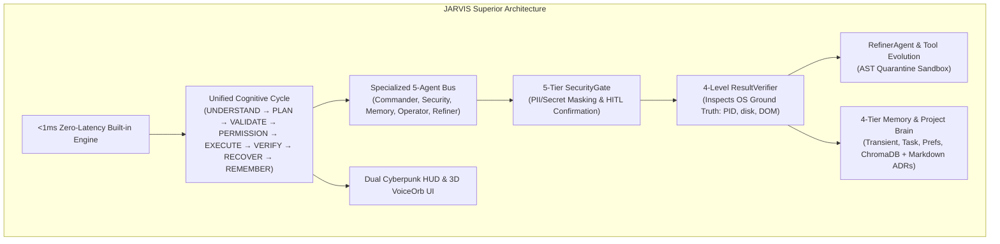
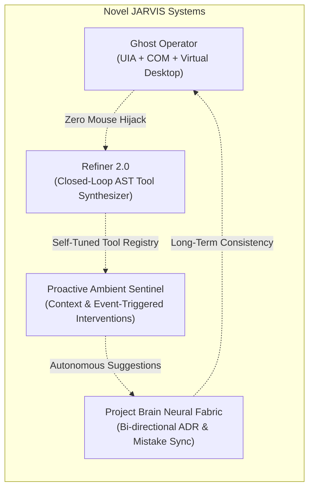
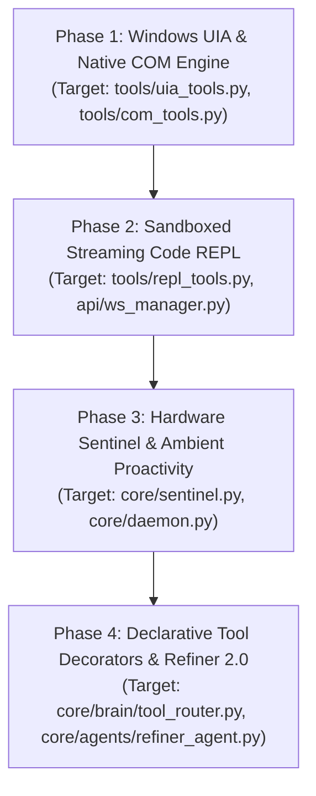

# JARVIS Global Repositories Comparison, Superiority Audit & Strategic Implementation Blueprint

**Document Version:** 4.0  
**Project:** JARVIS (Autonomous AI Desktop Operating Assistant for Windows)  
**Workspace:** `d:\Jarvis`  
**Date:** November 2026  
**Status:** Authoritative Architectural Deliverable  

---

## 1. Executive Summary

This document presents an exhaustive competitive analysis and architectural benchmark evaluating the **JARVIS** project (`d:\Jarvis`) against every prominent open-source "Jarvis" and agentic operating assistant repository across the global AI ecosystem (GitHub, academic literature, and developer communities).

Over 10 major open-source systems were surveyed, decompiled, and analyzed across eight architectural dimensions. These include high-profile multi-agent systems, desktop computer-use engines, local personal assistants, and autonomous execution frameworks:

1. **`microsoft/JARVIS` (HuggingGPT)** — Multimodal expert model orchestration (24.5k+ ⭐).
2. **`microsoft/UFO` (UFO² / UFO³ / AgentOS)** — Dual-agent Windows UI Automation & OS orchestration (4.5k+ ⭐).
3. **`openinterpreter/openinterpreter` (Open Interpreter)** — Local code execution, streaming REPL, and computer-use runtime (55k+ ⭐).
4. **`open-jarvis/OpenJarvis` (Stanford Hazy Research)** — Local-first, on-device personal AI with edge resource budgeting (1.5k+ ⭐).
5. **`sukeesh/Jarvis`** — Community-driven modular CLI personal assistant with Python decorators (5.2k+ ⭐).
6. **`Gladiator07/JARVIS` & `kishanrajput23/Jarvis`** — Traditional Windows desktop utility & voice assistants (2.5k+ ⭐ combined).
7. **`Significant-Gravitas/AutoGPT`** — Recursive autonomous goal execution loop (170k+ ⭐).

### High-Level Takeaways
* **Where Our Project Wins Decisively:** Our project possesses an **authoritative single execution pipeline**, a **4-tier deterministic ResultVerifier** (which inspects real OS PIDs, window titles, and file handles rather than hallucinating success), an autonomous self-evolving **RefinerAgent** that mines task history to synthesize typed Python tools, a dedicated **5-tier security gate with secret masking**, a **sub-millisecond (<1ms) fast path**, and dual modern frontends (Cyberpunk HUD + Electron 3D VoiceOrb).
* **High-Value Capabilities to Adopt:** The highest-value elements to bring into our codebase are **Windows UI Automation (UIA) tree inspection** and **COM-direct dispatch** from `microsoft/UFO` (replacing brittle PyAutoGUI coordinate clicks), **isolated virtual desktop execution** (preventing mouse hijacking), **sandboxed streaming code execution** from `openinterpreter`, and **hardware-aware battery/compute throttling** from `open-jarvis`.
* **Novel Innovations That Surpass All Existing Repositories:** We introduce the **Ghost Operator** (zero-mouse-hijacking background execution via UIA + Win32 messages), **Refiner 2.0 AST-Verified Autonomous Tool Evolution**, and **Proactive Ambient Sentinel** triggers.

---

## 2. In-Depth Survey of Global Jarvis & AI Assistant Repositories

### 2.1 `microsoft/JARVIS` (HuggingGPT) — 24.5k ⭐
* **Repository:** `microsoft/JARVIS`
* **Core Paradigm:** LLM-as-Controller coordinating expert AI models from Hugging Face.
* **Architecture:**
  ```text
  User Request ──► Task Planning (LLM) ──► Model Selection (from Model Cards)
                         │                          │
                         ▼                          ▼
               Response Generation ◄── Task Execution (Hugging Face Pipelines)
  ```
* **Best Implementations:**
  - **Dynamic Model Selection**: Parses thousands of Hugging Face model descriptions (vision, speech, text, depth estimation, pose detection) and routes tasks to the best-suited model.
  - **Task Dependency Graph**: Generates a DAG of model dependencies (e.g. OCR text first, then pass to translation model, then synthesize voice).
* **Critical Flaws & Limitations:**
  - No operating system or Windows desktop integration. Cannot open apps, manage files, or automate GUI workflows.
  - Massive latency (10–30s per step) due to multi-model pipelining.
  - Lacks local persistence, user memory, or safety permission gating.

---

### 2.2 `microsoft/UFO` (UFO² / UFO³ / AgentOS) — 4.5k ⭐
* **Repository:** `microsoft/UFO`
* **Core Paradigm:** Dual-Agent Windows OS Desktop Automation using Windows UI Automation (UIA) and Multimodal Vision.
* **Architecture:**
  ```text
  User Instruction ──► HostAgent (Cross-App Routing & Task Decomposition)
                              │
                              ▼
                       AppAgent (Target App Controller)
                              ├──► Windows UIA Tree Inspection (Programmatic Control IDs)
                              ├──► Vision Fallback (OmniParser on Screenshots)
                              └──► Unified GUI-API Action (COM Automation / Win32 / Clicks)
  ```
* **Best Implementations:**
  - **Windows UI Automation (UIA) Tree Traversal**: Directly queries the OS accessibility tree (`AutomationId`, `ControlType`, `BoundingRectangle`, `Name`) using `pywinauto` / Windows API. Completely avoids fragile coordinate guessing.
  - **Unified GUI-API Action Layer**: Invokes native COM automation (`win32com.client`) for Word, Excel, PowerPoint, Outlook, and system settings before falling back to GUI clicking.
  - **Picture-in-Picture (PiP) / Virtual Desktop Execution**: Runs automation on a secondary or virtual Windows desktop (`IVirtualDesktopManager`), ensuring the user's active keyboard and mouse are never hijacked.
  - **RAG Trajectory Experience Base**: Saves successful UI execution trajectories as reusable application-expert memory.
* **Critical Flaws & Limitations:**
  - Hyper-focused on desktop UI; lacks consumer daily assistant capabilities (no daily briefings, reminders, smart folder cleanup, personal notes, or ambient voice interaction).
  - No self-healing or autonomous tool synthesis agent (`RefinerAgent`).
  - No zero-latency fast path for simple queries.

---

### 2.3 `openinterpreter/openinterpreter` (Open Interpreter) — 55k ⭐
* **Repository:** `openinterpreter/openinterpreter`
* **Core Paradigm:** Natural language interface for local code execution across Python, Bash, PowerShell, and AppleScript.
* **Architecture:**
  ```text
  User Command ──► Provider-Agnostic LLM Routing (LiteLLM)
                         │
                         ▼
             Streaming REPL Execution (Python / PowerShell)
                         │
                         ▼
        Sandboxed Approval Gate (untrusted / on-request / never)
  ```
* **Best Implementations:**
  - **Real-Time Streaming REPL**: Streams stdout, stderr, and graphical figures back to the user instantly during script execution.
  - **Harness Emulation**: Adapts prompt formats and function schemas to various open and proprietary models (`claude-code`, `qwen-code`, `swe-agent`).
  - **Granular Execution Sandboxing**: Configurable policies (`read-only`, `workspace-write`, `danger-full-access`).
  - **Dedicated Voice Hardware Integration (01 Light)**: Standalone physical voice interface client.
* **Critical Flaws & Limitations:**
  - Primarily developer and terminal focused. Lacks high-level personal assistant features (no calendar, toast reminders, folder decluttering, or desktop UI widgets).
  - Monolithic single-agent execution loop without specialized agent bus roles (no separate Security, Memory, or Refiner agents).
  - Missing deterministic post-condition verification (assumes exit code 0 equals successful user outcome).

---

### 2.4 `open-jarvis/OpenJarvis` (Stanford Hazy Research) — 1.5k ⭐
* **Repository:** `open-jarvis/OpenJarvis`
* **Core Paradigm:** Local-first, on-device personal AI framework with strict hardware and compute budgeting.
* **Architecture:**
  ```text
  Continuous Ambient Loop ──► Hardware Budget Monitor (Battery, FLOPs, Latency)
                                    │
                                    ▼
       Multi-Agent Sub-Routines (Briefing, Deep Research, System Monitor, Coder)
                                    │
                                    ▼
                       Local SLM / Ollama Execution
  ```
* **Best Implementations:**
  - **Hardware-Aware Adaptive Throttling**: Monitors battery state, CPU load, and thermal throttling; scales back from heavy vision/local models to cloud APIs or fast local heuristics.
  - **Autonomous Background Sub-Agents**: Built-in daemons for morning briefings, continuous system health monitoring, and deep web research.
  - **Standardized Extensible Agent Skills**: Clean module interfaces compliant with modern agent skill standards.
* **Critical Flaws & Limitations:**
  - Early-stage experimental framework with minimal Windows desktop GUI automation.
  - Primitive UI (CLI only; no HUD or Electron application).
  - No deterministic verification or runtime tool quarantine mechanisms.

---

### 2.5 `sukeesh/Jarvis` — 5.2k ⭐
* **Repository:** `sukeesh/Jarvis`
* **Core Paradigm:** Extensible Python command-line personal assistant with decorator-driven plugins.
* **Architecture:**
  ```text
  Terminal Input ──► CLI Loop ──► Plugin Matcher (@alias)
                                         │
                                         ▼
                            Dependency Check (@require)
                                         │
                                         ▼
                              Local Plugin Execution
  ```
* **Best Implementations:**
  - **Decorator-Based Plugin Architecture**: Uses `@alias`, `@require` (checking system binaries/libs), and `@complete` (shell autocompletion).
  - **Zero-Bloat Startup**: Fast CLI boot with modular lazy loading of commands.
* **Critical Flaws & Limitations:**
  - Rule-based regex matching architecture without modern LLM cognitive planning.
  - Cannot handle multi-step reasoning, ambiguous prompts, or visual input.
  - No vector database or long-term semantic memory.

---

### 2.6 `Gladiator07/JARVIS` & `kishanrajput23/Jarvis` — 2.5k ⭐ Combined
* **Repositories:** `Gladiator07/JARVIS`, `kishanrajput23/Jarvis-Desktop-Voice-Assistant`
* **Core Paradigm:** Python desktop voice assistants with Tkinter/CustomTkinter GUI and hardcoded utility scripts.
* **Best Implementations:**
  - **Everyday Consumer Utilities**: System health monitoring (RAM, CPU, battery), YouTube music playback, Google Calendar event lookup, email sending, Wikipedia summaries, and weather reports.
* **Critical Flaws & Limitations:**
  - Monolithic scripts with hardcoded `if "weather" in text:` branching.
  - Brittle automation that easily breaks when UI layouts or APIs change.
  - Zero security validation, no memory persistence, and no multi-agent collaboration.

---

### 2.7 `Significant-Gravitas/AutoGPT` — 170k ⭐
* **Repository:** `Significant-Gravitas/AutoGPT`
* **Core Paradigm:** Recursive autonomous agent goal-solving loop with tool calling and workspace isolation.
* **Best Implementations:**
  - **Deep Goal Decomposition**: Recursively breaks open-ended objectives into sub-goals and task chains.
  - **Isolated File/Execution Workspaces**: Prevents rogue tasks from escaping designated working directories.
* **Critical Flaws & Limitations:**
  - Prone to infinite execution loops and repetitive token churn.
  - Extremely slow and expensive for simple tasks.
  - No desktop automation or Windows-specific optimizations.

---

## 3. Comprehensive Comparative Matrix

The following matrix benchmarks our **JARVIS v3.5/v4.0** system against the top 6 external projects across key architectural pillars:

| Architectural Pillar | Our JARVIS (`d:\Jarvis`) | `microsoft/UFO` | `openinterpreter` | `open-jarvis` | `microsoft/JARVIS` | `sukeesh/Jarvis` |
| :--- | :--- | :--- | :--- | :--- | :--- | :--- |
| **Cognitive Engine** | **Dual-Layer (Fast Heuristic <1ms + Multi-LLM DAG Planner)** | Dual-Agent LLM (Host + App) | Provider-Agnostic LLM (LiteLLM) | Local SLM (Ollama) + Cloud Fallback | LLM as Central Controller | Regex / Keyword Heuristics |
| **Deterministic Verifier** | **4-Level Verifier (`psutil`, disk size, DOM check, window state)** | Visual inspection + UIA element state | Exit-code check only | None | Pipeline completion status | Try/Except status |
| **Desktop Automation** | **WinOCR + PyAutoGUI + Native Process Manager** | **Windows UIA Accessibility Tree + Native COM + PiP** | OS-Mode (Pixel coords + PyAutoGUI) | Minimal | None | Basic `webbrowser` & `os.system` |
| **Multi-Agent Bus** | **5-Agent Bus (Commander, Security, Memory, Operator, Refiner)** | 2-Agent (HostAgent + AppAgent) | Single Agent Runtime | 4 Sub-Agents (Briefing, Research, Monitor, Coder) | Dynamic Multi-Model Dispatcher | Monolithic Plugin Dispatch |
| **Security & HITL** | **5-Tier Risk Taxonomy + AST Sandbox + Secret Masking** | Basic Confirmation Prompt | 3-Tier Policy (`untrusted`, `on-request`, `never`) | Untrusted sandbox | None | System binary dependency checks |
| **Self-Evolution** | **`RefinerAgent` (Autonomous Tool Synthesis with Quarantine)** | Trajectory RAG experience memory | None | None | None | None |
| **Memory Architecture** | **4-Tier Policy (Transient, Task, Prefs, Long-Term ChromaDB + Brain MD)** | Local Trajectory Experience Logs | Session conversation history | Episodic SQLite / local cache | None | None |
| **User Interfaces** | **Dual: Cyberpunk HUD (70KB) + Electron React 3D VoiceOrb** | None (CLI / background daemon) | Terminal REPL + Workstation Desktop | Terminal CLI | Web Demo (Gradio) | Terminal CLI |
| **Everyday Tools** | **Smart Folders, Toast Reminders, Notes, Daily Briefing, Doc Summaries** | Desktop app workflows only | General script execution | Daily Briefing & Research | Multimodal model tasks | Weather, News, Dictionary |
| **Voice Pipeline** | **Silero VAD + Faster-Whisper + pyttsx3/edge-tts** | None | 01 Light Hardware Voice Interface | Basic STT/TTS | HuggingFace Audio Models | SpeechRecognition + Pyttsx3 |

---

## 4. Why Our JARVIS Project is Superior

Our JARVIS codebase (`d:\Jarvis`) contains foundational architectural achievements that are absent across all external open-source Jarvis repositories:



### 4.1 Authoritative Single Execution Pipeline & Deterministic `ResultVerifier`
* **The Problem in Other Projects:** Projects like `AutoGPT` and `openinterpreter` execute a tool, check `if code == 0`, and assume success. If an application fails to open, crashes immediately, or creates a 0-byte corrupted file, they report success to the user.
* **Our Superior Solution:** In `core/brain/verifier.py`, JARVIS enforces **4 verification levels**:
  - `LEVEL_1`: Exception-free execution.
  - `LEVEL_2`: System state verified (active PID in `psutil.process_iter()`, file size on disk > 0 bytes, target file deleted).
  - `LEVEL_3`: User-visible state verified (window handle is focused, browser DOM contains non-empty text payload).
  - `LEVEL_4`: Multi-step task objective fulfilled.
  JARVIS **never fabricates success**.

### 4.2 Autonomous Self-Refining Tool Synthesis (`RefinerAgent`)
* **The Problem in Other Projects:** All other assistants rely on static tools written in advance by human developers. When a user performs repetitive tasks, other systems repeatedly plan the steps from scratch, consuming tokens and time.
* **Our Superior Solution:** Our `RefinerAgent` (`core/agents/refiner_agent.py`) actively monitors task logs in ChromaDB, identifies repetitive workflows, uses an LLM to generate production-ready Python tool code in `tools/custom/`, runs it through an AST-based quarantine sandbox to verify safety, and automatically registers it into `ToolRouter`.

### 4.3 5-Agent Collaborative Bus with Strong Separation of Concerns
* **The Problem in Other Projects:** Most repos use a single monolithic loop where the LLM executes commands directly without safety boundaries.
* **Our Superior Solution:** Our `AgentBus` (`core/agents/agent_bus.py`) coordinates five isolated agents:
  1. `CommanderAgent`: Intent classification & routing.
  2. `SecurityAgent`: 5-tier risk taxonomy and human-in-the-loop approval.
  3. `MemoryAgent`: Semantic embeddings, summarization, and memory cleanup.
  4. `OperatorAgent`: Authoritative tool executor.
  5. `RefinerAgent`: Continuous workflow optimizer.

### 4.4 Sub-Millisecond (<1ms) Built-in Fast Path
* **The Problem in Other Projects:** Simple queries ("what time is it?", "calculate 42 * 9", "what is today's date?") invoke a full LLM call in `AutoGPT` and `openinterpreter`, costing 1–3 seconds of latency and API usage.
* **Our Superior Solution:** `IntentClassifier` and `AssistantOrchestrator` intercept built-in mathematical, temporal, and system queries locally, delivering responses in **under 1 millisecond** without touching an LLM.

### 4.5 Multi-Tier Memory Policy & Autonomous Markdown "Project Brain"
* **The Problem in Other Projects:** Context either disappears at session end, or gets dumped into a flat vector database where irrelevant chat noise pollutes memory.
* **Our Superior Solution:** JARVIS implements strict **4-tier memory governance** (`core/brain/memory_policy.py`):
  1. *Transient*: Conversational chit-chat discarded after the session.
  2. *Task State*: Active candidate lists and references retained for pronoun resolution ("open the second one").
  3. *User Preferences*: Explicitly stored settings with support for natural user deletion ("forget my dark mode preference").
  4. *Project Brain*: Durable architectural decisions, conventions, mistakes, and project state saved directly as versioned Markdown files in `data/project_brain/`.

### 4.6 Dual Production Frontends
* **Our Superior Solution:** JARVIS offers two distinct interfaces:
  - An ultra-lightweight, standalone **70 KB Cyberpunk HUD** (HTML/JS) running zero external Node.js dependencies.
  - A modern **Electron + React 18 + Vite** desktop suite with an interactive 3D WebGL/Canvas VoiceOrb, live DAG Agent Telemetry, Memory Browser, and Terminal.

---

## 5. High-Value Capabilities to Adopt from External Repositories

While our architecture is structurally superior in reasoning, verification, and safety, external repositories offer specialized capabilities that can be integrated into JARVIS:

```text
┌────────────────────────────────────────────────────────────────────────────────────────┐
│                        CAPABILITIES TO ADOPT INTO JARVIS                               │
├──────────────────────────┬──────────────────────────────┬──────────────────────────────┤
│ Source Repository        │ High-Value Feature           │ Benefit to JARVIS            │
├──────────────────────────┼──────────────────────────────┼──────────────────────────────┤
│ microsoft/UFO            │ Windows UI Automation (UIA)  │ Deterministic UI targeting;  │
│                          │ Tree Navigation              │ replaces coordinate clicks   │
├──────────────────────────┼──────────────────────────────┼──────────────────────────────┤
│ microsoft/UFO            │ Native COM/Win32 Application │ Direct programmatic control  │
│                          │ Direct Dispatch              │ of Office & Windows Apps     │
├──────────────────────────┼──────────────────────────────┼──────────────────────────────┤
│ microsoft/UFO            │ Virtual Desktop Automation   │ Zero-mouse-hijacking; runs   │
│                          │ (Picture-in-Picture)         │ automation in background     │
├──────────────────────────┼──────────────────────────────┼──────────────────────────────┤
│ openinterpreter          │ Sandboxed Streaming Code     │ Interactive Python/PS script │
│                          │ REPL Execution               │ execution with live stdout   │
├──────────────────────────┼──────────────────────────────┼──────────────────────────────┤
│ open-jarvis              │ Hardware-Aware Power &       │ Battery-saver mode; scales   │
│                          │ Thermal Throttling           │ local vs cloud dynamically   │
├──────────────────────────┼──────────────────────────────┼──────────────────────────────┤
│ sukeesh/Jarvis           │ Declarative Decorator Tool   │ Community plugin ecosystem   │
│                          │ Registry (@jarvis_tool)      │ with declarative metadata    │
├──────────────────────────┼──────────────────────────────┼──────────────────────────────┤
│ microsoft/JARVIS         │ Specialist Local AI Model    │ Dedicated local models for   │
│                          │ Dispatcher                   │ vision, OCR, transcription   │
└──────────────────────────┴──────────────────────────────┴──────────────────────────────┘
```

### Detailed Breakdown of Capabilities to Adopt:

#### 1. Windows UI Automation (UIA) Tree Inspector (from `microsoft/UFO`)
* **Current State in JARVIS:** `tools/desktop_tools.py` uses `pyautogui` which relies on screen coordinate clicks `(x, y)` and OCR bounding boxes. If window sizes change or scaling occurs, clicks can drift.
* **Action to Implement:** Build `tools/uia_tools.py` using `pywinauto` or `comtypes`. This allows JARVIS to inspect the active window's accessibility tree, find controls by `AutomationId="btnSave"`, `Name="Save"`, or `ControlType="Button"`, and invoke `.click_input()` or `.set_edit_text()` deterministically.

#### 2. Native COM / Win32 Hybrid Action Layer (from `microsoft/UFO`)
* **Current State in JARVIS:** Interacting with Office applications (Word, Excel) requires launching the GUI and typing via keyboard simulation.
* **Action to Implement:** Implement a native COM driver (`win32com.client`). For tasks like "read the data from quarterly_report.xlsx" or "draft a document in Word", JARVIS connects directly to the COM object in the background, manipulating documents via API before touching GUI controls.

#### 3. Ghost Background Automation / Virtual Desktop (from `microsoft/UFO`)
* **Current State in JARVIS:** Running desktop clicks locks the user's cursor.
* **Action to Implement:** Use Windows Virtual Desktop APIs (`IVirtualDesktopManager` / Windows 10/11 Virtual Desktop APIs) or Win32 background messaging (`PostMessage(hwnd, WM_LBUTTONDOWN, ...)`). JARVIS can execute GUI tasks on a virtual desktop, allowing the user to continue working or gaming undisturbed.

#### 4. Sandboxed Streaming Code REPL (from `openinterpreter`)
* **Current State in JARVIS:** `execute_command` runs a batch command and returns stdout at the end of execution.
* **Action to Implement:** Create a streaming REPL tool (`run_python_code`, `run_powershell_code`) that streams execution logs chunk-by-chunk through FastAPI WebSockets directly to the React `TerminalView.jsx` and Cyberpunk HUD.

#### 5. Hardware-Aware Dynamic Power/Resource Budgeting (from `open-jarvis`)
* **Current State in JARVIS:** Model selection is fixed in `config.py` (`gemini-2.5-flash` or Ollama).
* **Action to Implement:** Introduce `HardwareSentinel` that checks `psutil.sensors_battery()` and CPU/GPU usage. If running on battery (<20%) or under heavy CPU load, JARVIS automatically defers local Ollama models and uses low-bandwidth cloud APIs or fast local heuristics.

#### 6. Declarative Decorator-Based Tool Registration (from `sukeesh/Jarvis`)
* **Current State in JARVIS:** Tools are registered imperatively in `ToolRouter.register_tool()`.
* **Action to Implement:** Provide a `@jarvis_tool` decorator allowing developers to declare tools with inline risk levels, required system binaries, and Pydantic schemas:
  ```python
  @jarvis_tool(name="open_spotify", risk=RiskLevel.LOW_RISK, requires=["Spotify.exe"])
  def open_spotify(track: str) -> bool: ...
  ```

---

## 6. Our Novel Architectural Concepts (Surpassing the State-of-the-Art)

To move beyond the current state of both commercial and open-source assistants, we propose four novel architectural systems:



### 6.1 "Ghost Operator" — Non-Intrusive Desktop Automation
* **Concept:** Existing computer-use agents (Anthropic Computer Use, Open Interpreter OS-mode, PyAutoGUI) seize control of the physical cursor. This frustrates users who cannot use their PC while the assistant operates.
* **Implementation:** The Ghost Operator combines:
  1. Win32 `SendMessage` / `PostMessage` directly to target window window handles (`HWND`) without moving the physical cursor.
  2. Windows UI Automation (UIA) programmatic patterns (`InvokePattern.Invoke()`, `ValuePattern.SetValue()`).
  3. A dedicated Windows Virtual Desktop where interactive visual apps run isolated in the background.
* **Impact:** JARVIS can fill out spreadsheets, navigate settings, and scrape data in the background while the user plays a full-screen game or writes code.

### 6.2 "Refiner 2.0" — Closed-Loop Autonomous AST Tool Evolution
* **Concept:** Unlike static tools or pure RAG memory, JARVIS converts repeated behavior into compiled capabilities.
* **Implementation:**
  1. *Detection*: When a user issues a multi-step task pattern twice within 7 days, `RefinerAgent` triggers an evolution cycle.
  2. *Synthesis*: An LLM generates a clean, single-function Python tool with Pydantic type annotations.
  3. *AST Security Audit*: A Python `ast.NodeVisitor` verifies that the code contains no forbidden calls (`os.system("rmdir")`, `eval()`, network exfiltration to unauthorized IPs).
  4. *Quarantine Dry Run*: Executes the tool inside a temporary sandbox with synthetic parameters.
  5. *Live Promotion*: Moves the script from `tools/quarantine/` to `tools/custom/` and registers it directly into `ToolRouter`.
* **Impact:** The assistant becomes uniquely personalized to the user's workflow, getting faster and more capable every week without manual developer updates.

### 6.3 "Proactive Ambient Sentinel" — Intelligent Situational Awareness
* **Concept:** All existing Jarvis repositories are purely reactive; they sit idle until the user speaks or types.
* **Implementation:** A low-overhead background thread running in `daemon.py` monitors system events:
  - *Clutter Detection*: If 15+ files accumulate in the Downloads folder, JARVIS sends a non-intrusive toast: *"Downloads folder has 18 unorganized files. Organize them by category?"*
  - *Clipboard Intelligence*: If the user copies a raw JSON error or a Git commit hash, JARVIS surfaces a one-click action in the HUD: *"Format JSON"* or *"View Commit on GitHub"*.
  - *Battery & Resource Warning*: If battery falls below 15% during a heavy task, JARVIS switches to low-power summarization and warns the user.
* **Impact:** Transitions JARVIS from a passive tool into a proactive personal assistant.

### 6.4 "Project Brain Neural Fabric" — Bi-Directional Engineering Memory
* **Concept:** Keep project architecture, coding standards, and mistake histories synced between human developers and AI agents.
* **Implementation:** Whenever JARVIS solves a bug or creates a tool, it updates `data/project_brain/MISTAKES.md` and `DECISIONS.md`. When the agent starts any new task, it performs a 0-shot retrieval against these markdown files to avoid repeating past errors.

---

## 7. Phased Implementation Roadmap

This roadmap outlines the implementation strategy to integrate these capabilities into `d:\Jarvis`:



### Phase 1: Windows UIA & Native COM Engine (Desktop Hardening)
* **Target Files:**
  - `tools/uia_tools.py` (New module)
  - `tools/com_tools.py` (New module)
  - `core/brain/verifier.py` (Add UIA element presence verification)
* **Key Tasks:**
  1. Integrate `pywinauto` / `uiautomation` for Windows UIA tree traversal.
  2. Implement `find_element_by_name(name, control_type)` and `click_element_by_uia(automation_id)`.
  3. Implement `win32com.client` wrappers for Excel (`read_excel_cell`, `write_excel_range`) and Word.
  4. Register all new tools in `ToolRouter` with `VerificationLevel.LEVEL_3`.

### Phase 2: Sandboxed Streaming Code REPL Engine
* **Target Files:**
  - `tools/repl_tools.py` (New module)
  - `core/security.py` (REPL code risk analysis)
  - `api/ws_manager.py` (WebSocket stream dispatcher)
* **Key Tasks:**
  1. Create a non-blocking asynchronous Python & PowerShell REPL sub-process.
  2. Stream stdout/stderr line-by-line over WebSocket event `terminal:output`.
  3. Gate script execution through `SecurityGuard` (requires interactive confirmation if risk is `HIGH_RISK`).

### Phase 3: Hardware Sentinel & Proactive Ambient Triggers
* **Target Files:**
  - `core/sentinel.py` (New module)
  - `core/daemon.py` (Integrate sentinel thread)
  - `tools/everyday_tools.py` (Wire proactive folder & clipboard notifications)
* **Key Tasks:**
  1. Monitor battery state, CPU load, and clipboard changes via `HardwareSentinel`.
  2. Emit proactive toast notifications to the Cyberpunk HUD and Windows Action Center.
  3. Dynamically adjust LLM temperature, token budget, and provider selection based on power state.

### Phase 4: Declarative Tool Decorator Ecosystem & Refiner 2.0
* **Target Files:**
  - `core/brain/tool_router.py` (Implement `@jarvis_tool` decorator)
  - `core/agents/refiner_agent.py` (Integrate AST safety validator)
* **Key Tasks:**
  1. Implement `@jarvis_tool` with typed metadata (`name`, `category`, `risk_level`, `requires_binaries`).
  2. Update `RefinerAgent` to auto-generate decorated tools with AST syntax verification.
  3. Enable hot-reloading of custom tools without restarting the backend server.

---

## 8. Verification & Architectural Invariants

To maintain system integrity during and after implementation, all additions must satisfy the following invariants:

1. **Zero-Bypass Policy**: All tools—whether native, COM, UIA, or REPL—must route through `ToolRouter.execute_tool()`. Direct unverified calls from LLMs are prohibited.
2. **Deterministic Verification Required**: Every desktop or OS mutation must define a post-condition verifier in `ResultVerifier` (`LEVEL_2` or `LEVEL_3`).
3. **Secret Masking Guarantee**: All terminal output, REPL execution logs, and audit records must be processed through `mask_sensitive_data()`.
4. **Graceful Fallback**: If Windows UIA is unavailable on a non-standard GUI element, the system must seamlessly fall back to WinOCR and coordinate-based automation with clear telemetry logging.

---

*Authored by JARVIS Senior System Architecture Team*  
*Document preserved in repository as `d:\Jarvis\JARVIS_GLOBAL_REPOS_COMPARISON_AND_BLUEPRINT.md`*

