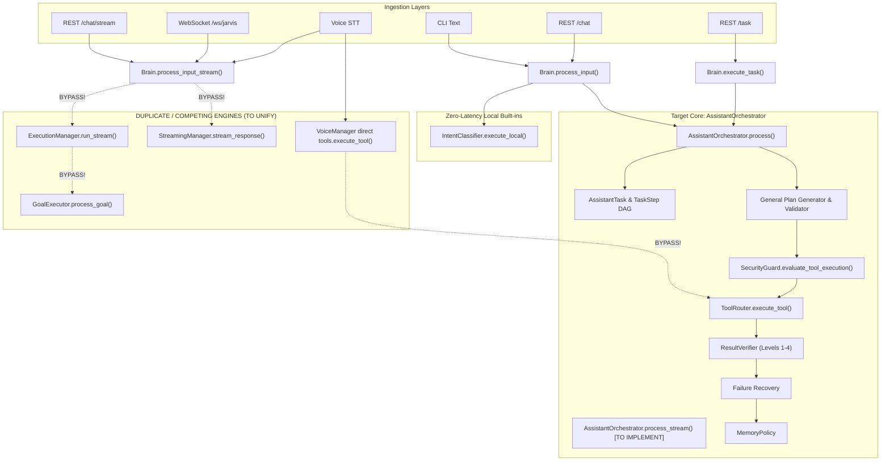

# JARVIS Phase 3.5 — Architecture & Execution Path Audit

## Executive Summary

This audit inspects every entry point and execution pathway in the JARVIS codebase where a user request can trigger tool execution or autonomous actions. The objective is to identify all competing execution loops, bypasses, and inconsistencies between Text, Voice, Streaming, REST API, WebSocket, and Desktop interfaces, establishing the foundation for **ONE ASSISTANT CORE**.

---

## 1. Inventory of Entry Points

JARVIS currently receives user requests through 6 distinct ingestion channels:

| Ingestion Channel | File / Module | Method / Handler | Protocol |
| :--- | :--- | :--- | :--- |
| **CLI (Interactive)** | `main.py` | `main()` loop | Stdin / Console |
| **CLI (Task Flag)** | `main.py` | `--task <goal>` | CLI argument |
| **REST Chat** | `api/server.py` | `@app.post("/chat")` | HTTP POST |
| **REST Stream** | `api/server.py` | `@app.post("/chat/stream")` | Server-Sent Events (SSE) |
| **REST Task** | `api/server.py` | `@app.post("/task")` | HTTP POST |
| **WebSocket** | `api/server.py` | `@app.websocket("/ws/jarvis")` | WebSocket (`command: "chat"`) |
| **Continuous Voice** | `core/voice_manager.py`| `ContinuousVoiceManager._listen_loop()`| Audio VAD -> STT |
| **Desktop GUI** | `desktop/src/App.jsx` | Electron WebSocket client | WebSocket to port 7799 |

---

## 2. Complete Execution Path Mapping

### Path A: CLI Interactive & REST `/chat`
```
User Text Input
   ↓
Brain.process_input()
   ↓ [Check local built-in via IntentClassifier.execute_local]
   ├─► Local built-in (<1ms): returns time, date, calc
   └─► AssistantOrchestrator.process()
         ↓
       Task Model (AssistantTask: UNDERSTANDING -> PLANNING)
         ↓
       _create_plan() [Phase 3 regex patterns]
         ↓
       ToolRouter.execute_tool()
         ↓
       SecurityGuard.evaluate_tool_execution()
         ↓
       Tool Callable
         ↓
       ResultVerifier.verify_tool_result()
         ↓
       MemoryPolicy -> MemoryManager
         ↓
       Response String
```

### Path B: REST `/task`
```
Client HTTP POST /task
   ↓
Brain.execute_task()
   ↓
AssistantOrchestrator.process() [Phase 3 path]
   ↓
(Executes via Path A)
```

### Path C: REST `/chat/stream` & WebSocket `/ws/jarvis` (COMPETING PATH!)
```
WebSocket / SSE Request
   ↓
Brain.process_input_stream()
   ↓ [Check IntentClassifier.execute_local]
   ├─► Local built-in
   ├─► Local ToolRouter.execute_tool() directly [Bypasses Orchestrator!]
   ├─► CommanderAgent.process()
   │     └─► If intent == "task":
   │           ExecutionManager.run_stream() -> GoalExecutor [COMPETING DAG ENGINE!]
   └─► StreamingManager.stream_response() -> ReasoningEngine.generate_stream()
```
**Defect Identified**: Streaming requests completely bypass `AssistantOrchestrator`! Instead of using the Phase 3 task model, verification, and recovery pipeline, streaming either calls tools directly through `ToolRouter` or spins up the legacy `ExecutionManager.run_stream()` / `GoalExecutor`!

### Path D: Continuous Voice Mode (COMPETING PATH!)
```
Microphone Audio -> VAD -> STT
   ↓
ContinuousVoiceManager._listen_loop()
   ↓ [Direct IntentClassifier.classify() call in VoiceManager]
   ├─► IntentClassifier.execute_local() -> speaks string
   ├─► Brain.tools.execute_tool(interactive=False) directly [Bypasses Orchestrator!]
   └─► Brain.process_input_stream() [Enters Path C above!]
         ↓
       Speaks stream via TTS
```
**Defect Identified**: Voice manager performs its own local intent classification and directly executes tools against `brain.tools.execute_tool()` without creating an `AssistantTask`, recording audit events, or engaging verification and recovery!

### Path E: Legacy ExecutionManager & GoalExecutor (COMPETING ENGINE!)
```
ExecutionManager.run() / GoalExecutor.process_goal()
   ↓
generate_dag() via raw LLM prompt
   ↓
validate_dag()
   ↓
preview_plan() -> approval_event.wait()
   ↓
AgentBus -> OperatorAgent -> ToolRouter.execute_tool()
```
**Defect Identified**: `GoalExecutor` represents a parallel planning and DAG engine that duplicates `AssistantOrchestrator`. It creates its own `GoalPlan` and `TaskNode` models instead of using `AssistantTask` and `TaskStep`.

---

## 3. Graph of All Execution Paths



---

## 4. Key Architectural Defects Discovered

1. **Streaming Execution Bypass**:
   `Brain.process_input_stream()` does not route through `AssistantOrchestrator`. Complex multi-step streaming requests invoke the legacy `ExecutionManager` or raw `StreamingManager`.
2. **Voice Execution Duplication**:
   `ContinuousVoiceManager` maintains its own intent classification and tool execution logic, bypassing task tracking and verification.
3. **Hard-Coded Pattern Matching**:
   `AssistantOrchestrator._create_plan()` relies on 3 regex heuristics. Arbitrary multi-step user requests fallback to a single reasoning node without planning.
4. **Terminal `input()` Blocking in Security Gate**:
   `SecurityGuard.evaluate_tool_execution()` calls Python's `input()` for `HIGH_RISK` actions, freezing FastAPI / WebSocket worker threads when accessed from the Desktop UI or WebSocket.
5. **Non-Enforced Timeouts**:
   `ToolSchema.timeout_seconds` exists as descriptive metadata but is not enforced during tool invocation in `ToolRouter`.
6. **Shallow Verification**:
   `ResultVerifier` treats basic non-empty string responses as verified success without distinguishing between tool execution, system state change, user-visible change, and objective completion.
7. **Task State Volatility**:
   Tasks exist only in memory during application runtime and are lost upon restart.

---

## 5. Unification Roadmap

1. Implement `AssistantOrchestrator.process_stream()` so streaming requests share the identical task, planning, execution, verification, and memory lifecycle.
2. Route `Brain.process_input_stream()` and `ContinuousVoiceManager` strictly through `AssistantOrchestrator`.
3. Deprecate competing execution in `ExecutionManager` and integrate `GoalExecutor`'s schema-driven DAG planning into `AssistantOrchestrator._create_plan_general()`.
4. Provide non-blocking WebSocket-based confirmation for the security gate.
5. Enforce timeouts using `concurrent.futures.ThreadPoolExecutor` in `ToolRouter`.
6. Upgrade `ResultVerifier` with explicit verification levels (1 to 4).
7. Persist task history across restarts in `data/tasks/task_history.json`.
